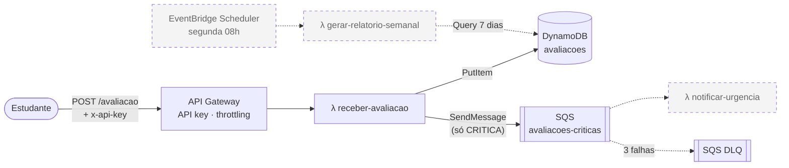

# Plataforma de Feedback Serverless

Tech Challenge da Fase 4, FIAP Pós-Tech Arquitetura e Desenvolvimento Java.

Estudantes avaliam aulas. Avaliações críticas geram aviso imediato para os administradores, e toda
semana sai um relatório com média, quantidade por dia e quantidade por urgência.
Tudo roda em funções serverless (AWS Lambda) com Quarkus e Java 21.

## Arquitetura



Linhas tracejadas: próximas etapas.

| Etapa | Status |
|---|---|
| `receber-avaliacao` (API Gateway + DynamoDB + SQS) | ✅ implementada |
| `notificar-urgencia` (consome a fila e envia o e-mail) | ⏳ próxima |
| `gerar-relatorio-semanal` (EventBridge Scheduler) | ⏳ próxima |
| Alarmes e dashboard no CloudWatch | ⏳ próxima |

## Estrutura do repositório

Cada Lambda é um **módulo Maven** separado, com seu código, testes e dependências. O build de cada
uma gera o seu próprio pacote (`<modulo>/target/function.zip`), que leva só o que aquela função usa.

```
tech-challenge4/
├── pom.xml                       # POM pai: lista os módulos e fixa as versões
├── template.yaml                 # infraestrutura (AWS SAM): UMA stack com todas as Lambdas
├── samconfig.toml                # parâmetros do sam deploy (stack, região us-east-2)
├── .github/workflows/ci-cd.yml   # PR: build + testes | merge na main: + deploy
├── infra/github-oidc.yaml        # role de deploy via OIDC (criada uma vez)
├── docs/passo-a-passo-deploy.md  # guia completo de deploy
│
├── shared/                       # domínio e contratos comuns (Java puro, sem AWS)
│   └── br/fiap/feedback/
│       ├── domain/     Avaliacao, Urgencia, AvaliacaoInvalidaException
│       └── contrato/   TabelaAvaliacoes (chaves do DynamoDB), MensagemAvaliacaoCritica (fila)
│
├── receber-avaliacao/            # ✅ λ POST /avaliacao
│   └── br/fiap/feedback/receber/
│       ├── function/   ReceberAvaliacaoHandler (borda: HTTP ↔ serviço)
│       ├── service/    AvaliacaoService (caso de uso)
│       ├── repository/ AvaliacaoRepository + DynamoDbAvaliacaoRepository
│       ├── messaging/  PublicadorAvaliacaoCritica + SqsPublicadorAvaliacaoCritica
│       └── config/     RelogioProducer
│
├── notificar-urgencia/           # ⏳ λ disparada pela fila SQS (ver README da pasta)
└── gerar-relatorio-semanal/      # ⏳ λ disparada pelo EventBridge Scheduler (ver README da pasta)
```

**Por que módulos separados:**
- A responsabilidade única de cada função fica visível na própria estrutura do repositório.
- Cada Lambda carrega só as suas dependências: pacote menor e cold start menor.
- O que é comum (regra de urgência, formato da tabela e da mensagem) fica num lugar só, o `shared`.
  Assim quem produz e quem consome nunca divergem.

**E o deploy continua único:** um pipeline e uma stack. O `mvn verify` na raiz gera os zips de
todas as Lambdas, e o `sam deploy` publica tudo de uma vez. No `template.yaml`, cada função aponta
para o seu pacote (`CodeUri: receber-avaliacao/target/function.zip`).

## Função `receber-avaliacao`

**Gatilho:** API Gateway, `POST /avaliacao`, com header `x-api-key` obrigatório.
**Responsabilidade:** validar, classificar a urgência e gravar a avaliação. Se for crítica, publica na fila.

```http
POST /prod/avaliacao
x-api-key: <chave>
Content-Type: application/json

{ "descricao": "Aula com áudio ruim", "nota": 2 }
```

| Resposta | Quando |
|---|---|
| `201` `{ "id", "descricao", "nota", "urgencia", "dataEnvio" }` | Avaliação gravada |
| `400` `{ "erro": "..." }` | JSON inválido, descrição vazia ou acima de 1000 caracteres, nota ausente, fora de 0–10 ou não inteira |
| `403` | Sem API key ou com API key inválida (barrado no API Gateway) |
| `500` `{ "erro": "..." }` | Falha inesperada (detalhes só no log) |

### Regra de urgência

O enunciado não define essa regra; esta foi a decisão do grupo.

| Nota | Urgência | Ação |
|---|---|---|
| 0 a 4 | `CRITICA` | Grava e publica na fila de notificação |
| 5 a 7 | `MEDIA` | Só grava (entra no relatório) |
| 8 a 10 | `BAIXA` | Só grava (entra no relatório) |

### Modelo de dados (DynamoDB)

| Atributo | Exemplo |
|---|---|
| `pk` (partição) | `DIA#2026-11-03` (dia no horário de Brasília) |
| `sk` (ordenação) | `2026-11-03T14:22:10Z#7f3c...` |
| `id`, `descricao`, `nota`, `urgencia`, `dataEnvio` | dados da avaliação |

Com a partição por dia, o relatório semanal faz 7 `Query` em vez de um `Scan` da tabela inteira.

### Decisões

- **Gravar antes de publicar:** se a fila falhar, a avaliação não se perde e o aluno recebe `201`.
  Assim ele não reenvia e não cria duplicata. A falha vai para o log com o marcador
  `FALHA_PUBLICACAO_CRITICA`, que vai alimentar um alarme do CloudWatch.
- **Sem dados pessoais nos logs:** a descrição é texto livre do aluno, então os logs registram só `id`, `nota` e `urgencia`.
- **Privilégio mínimo:** a role da função só tem `dynamodb:PutItem` na tabela e `sqs:SendMessage` na fila.
- **Custo zero:** DynamoDB em capacidade provisionada (cota Always Free), logs com retenção de 7 dias
  e criptografia com chaves gerenciadas pela AWS, sem custo.

## Como contribuir

A `main` é protegida: todo código entra por **pull request**.

```bash
git checkout main && git pull
git checkout -b feat/minha-mudanca
# ... código + testes ...
mvn verify                        # compila e testa todos os módulos
git push -u origin feat/minha-mudanca
# abra o PR no GitHub; o pipeline roda os testes; depois do merge, faz o deploy
```

## Deploy

Automático pelo GitHub Actions a cada merge na `main`. A primeira configuração (role OIDC + secret)
e como testar estão em [docs/passo-a-passo-deploy.md](docs/passo-a-passo-deploy.md).
