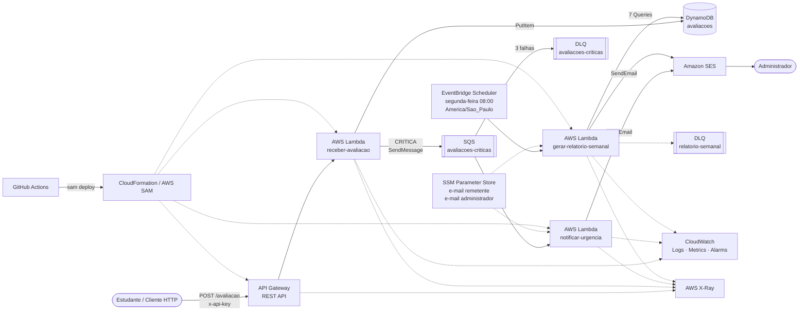

# Plataforma de Feedback Serverless

**Tech Challenge — Fase 4**
**FIAP Pós-Tech — Arquitetura e Desenvolvimento Java**

Plataforma serverless para recebimento de feedbacks de aulas, classificação automática de urgência, notificação de avaliações críticas e geração de relatório semanal.

A solução foi desenvolvida em **Java 21 + Quarkus** e executada em **AWS**, utilizando arquitetura orientada a eventos e serviços gerenciados.

---

## Integrantes

| Integrante | RM |
|---|---:|
| Felipe Ulson Sora | RM370766 |
| Gabriel Alberto Ferreira Pinto | RM374005 |
| Jeniffer da Nobrega Bandeira | RM371936 |

---

## Status da entrega

| Requisito | Status |
|---|---|
| Ambiente em cloud | ✅ Implementado |
| Arquitetura serverless | ✅ Implementado |
| Mínimo de 2 funções serverless | ✅ 3 Lambdas |
| Responsabilidade única | ✅ Implementado |
| Persistência em cloud | ✅ DynamoDB |
| Notificação automática de problemas críticos | ✅ SQS + Lambda + SES |
| Relatório semanal com média | ✅ EventBridge + Lambda + SES |
| Monitoramento | ✅ CloudWatch + X-Ray |
| Alarmes | ✅ 5 alarmes CloudWatch |
| Dashboard | ✅ CloudWatch Dashboard |
| Deploy automatizado | ✅ GitHub Actions + AWS SAM |
| CI em Pull Request | ✅ Maven build + testes |
| Repositório público | ✅ Disponível no GitHub |

---

# 1. Visão geral

O sistema permite que um estudante envie uma avaliação contendo:

```json
{
  "descricao": "Aula com áudio ruim",
  "nota": 2
}
```

A avaliação passa pelo seguinte fluxo:

1. O **API Gateway** recebe `POST /avaliacao`.
2. A Lambda `receber-avaliacao` valida os dados.
3. A nota é convertida em uma classificação de urgência.
4. A avaliação é persistida no **DynamoDB**.
5. Caso seja `CRITICA`, uma mensagem é publicada no **Amazon SQS**.
6. A Lambda `notificar-urgencia` consome a mensagem.
7. O administrador recebe um e-mail pelo **Amazon SES**.
8. Toda segunda-feira às 08h, o **EventBridge Scheduler** executa a Lambda `gerar-relatorio-semanal`.
9. A função consulta os sete dias anteriores e envia o relatório semanal por e-mail.

---

# 2. Arquitetura



A infraestrutura é criada como **uma única stack AWS SAM/CloudFormation**, chamada:

```text
feedback-serverless
```

Região utilizada:

```text
us-east-2
```

---

# 3. Modelo de cloud

Foi adotado o modelo **FaaS — Function as a Service**, utilizando AWS Lambda e serviços gerenciados.

A aplicação não mantém servidores de aplicação permanentemente provisionados. Cada função é executada a partir de um evento:

| Função | Evento |
|---|---|
| `receber-avaliacao` | Requisição HTTP pelo API Gateway |
| `notificar-urgencia` | Mensagem publicada no SQS |
| `gerar-relatorio-semanal` | EventBridge Scheduler |

Esse modelo oferece:

- execução sob demanda;
- baixo acoplamento;
- escalabilidade gerenciada pela AWS;
- separação de responsabilidades;
- infraestrutura reproduzível;
- integração nativa entre os componentes;
- redução de infraestrutura a administrar.

---

# 4. Tecnologias utilizadas

| Categoria | Tecnologia |
|---|---|
| Linguagem | Java 21 |
| Framework | Quarkus 3 |
| Build | Maven |
| Serverless | AWS Lambda |
| API | Amazon API Gateway |
| Persistência | Amazon DynamoDB |
| Mensageria | Amazon SQS |
| E-mail | Amazon SES |
| Agendamento | Amazon EventBridge Scheduler |
| Configuração | AWS Systems Manager Parameter Store |
| Infraestrutura como código | AWS SAM / CloudFormation |
| Monitoramento | Amazon CloudWatch |
| Distributed tracing | AWS X-Ray |
| CI/CD | GitHub Actions |
| Ambiente local AWS | LocalStack |
| Containerização local | Docker / Docker Compose |
| Testes | JUnit 5 / Mockito |

---

# 5. Estrutura do repositório

```text
tech-challenge4/
├── .github/
│   └── workflows/
│       └── ci-cd.yml
│
├── docs/
│   ├── README.md
│   └── ...
│
├── infra/
│   └── github-deploy-user.yaml
│
├── shared/
│   └── src/
│
├── receber-avaliacao/
│   ├── src/
│   └── pom.xml
│
├── notificar-urgencia/
│   ├── src/
│   └── pom.xml
│
├── gerar-relatorio-semanal/
│   ├── src/
│   ├── README.md
│   └── pom.xml
│
├── docker-compose.yml
├── template.yaml
├── samconfig.toml
├── pom.xml
├── .gitignore
└── README.md
```

Cada Lambda é um **módulo Maven independente**.

O módulo `shared` contém objetos e regras compartilhadas, evitando duplicação entre produtor e consumidor.

O build gera um pacote independente para cada função:

```text
receber-avaliacao/target/function.zip
notificar-urgencia/target/function.zip
gerar-relatorio-semanal/target/function.zip
```

O `template.yaml` aponta cada Lambda para o seu respectivo pacote.

---

# 6. Funções serverless

## 6.1 `receber-avaliacao`

**Gatilho:** API Gateway

```text
POST /avaliacao
```

Responsabilidades:

- desserializar a requisição;
- validar descrição;
- validar nota;
- classificar urgência;
- persistir no DynamoDB;
- publicar no SQS quando a avaliação for crítica.

Permissões IAM principais:

```text
dynamodb:PutItem
sqs:SendMessage
```

---

## 6.2 `notificar-urgencia`

**Gatilho:** fila SQS de avaliações críticas.

Responsabilidade única:

> enviar ao administrador o alerta sobre uma avaliação classificada como crítica.

O e-mail contém:

- descrição;
- nota;
- urgência;
- data de envio;
- identificador da avaliação.

O envio é realizado pelo **Amazon SES**.

Em caso de erro, a mensagem retorna à fila e pode ser reprocessada.

Após três tentativas sem sucesso, é encaminhada para a DLQ.

Permissão principal:

```text
ses:SendEmail
```

---

## 6.3 `gerar-relatorio-semanal`

**Gatilho:** EventBridge Scheduler.

Execução configurada para:

```text
cron(0 8 ? * MON *)
America/Sao_Paulo
```

Ou seja:

> toda segunda-feira, às 08:00 no horário de Brasília.

A função consulta os sete dias completos anteriores e gera um relatório contendo:

- período;
- total de avaliações;
- média das notas;
- quantidade de avaliações por dia;
- quantidade de avaliações por urgência;
- descrição das avaliações;
- nota;
- urgência;
- data de envio.

A consulta ao DynamoDB utiliza **uma Query por dia**, evitando `Scan` completo da tabela.

Permissões principais:

```text
dynamodb:Query
ses:SendEmail
```

---

# 7. Regra de urgência

O enunciado determina que problemas críticos sejam notificados, mas não estabelece como a urgência deve ser calculada.

A seguinte regra foi definida pelo grupo:

| Nota | Urgência | Comportamento |
|---|---|---|
| 0 a 4 | `CRITICA` | Persiste e publica no SQS |
| 5 a 7 | `MEDIA` | Persiste e entra no relatório semanal |
| 8 a 10 | `BAIXA` | Persiste e entra no relatório semanal |

A urgência é calculada no momento do recebimento e persistida junto à avaliação.

---

# 8. Modelo de dados

A tabela DynamoDB utiliza:

```text
pk = DIA#yyyy-MM-dd
sk = <dataEnvio>#<id>
```

Exemplo:

```text
pk = DIA#2026-11-03
sk = 2026-11-03T19:14:23.574345224Z#9b83f1d0-...
```

Atributos:

| Campo | Tipo | Descrição |
|---|---|---|
| `pk` | String | Partição por dia |
| `sk` | String | Timestamp + UUID |
| `id` | String | Identificador da avaliação |
| `descricao` | String | Feedback enviado |
| `nota` | Number | Nota de 0 a 10 |
| `urgencia` | String | `CRITICA`, `MEDIA` ou `BAIXA` |
| `dataEnvio` | String | Data/hora ISO-8601 |

A partição diária permite que a Lambda de relatório faça:

```text
7 dias = 7 Query
```

em vez de executar um `Scan` em toda a tabela.

O dia da partição considera o fuso:

```text
America/Sao_Paulo
```

---

# 9. Contrato da API

## Endpoint

```http
POST /prod/avaliacao
Content-Type: application/json
x-api-key: <API_KEY>
```

Body:

```json
{
  "descricao": "Excelente aula sobre AWS",
  "nota": 9
}
```

Exemplo de resposta:

```json
{
  "id": "e69231ec-6792-43e3-bc5a-b3ee1b34fa7c",
  "descricao": "Excelente aula sobre AWS",
  "nota": 9,
  "urgencia": "BAIXA",
  "dataEnvio": "2026-11-03T19:05:52.838211325Z"
}
```

## Respostas

| HTTP | Situação |
|---|---|
| `201` | Avaliação registrada |
| `400` | Requisição ou dados inválidos |
| `403` | API key ausente ou inválida |
| `500` | Falha interna inesperada |

A API key é utilizada para **controle de consumo e acesso ao endpoint**, juntamente com Usage Plan e throttling. Ela não representa autenticação de identidade de usuário.

---

# 10. Segurança e governança

A solução aplica os seguintes controles:

### HTTPS

A API pública é disponibilizada pelo API Gateway através de HTTPS.

### API Key e Usage Plan

O API Gateway exige:

```text
x-api-key
```

O Usage Plan também aplica limites de consumo e throttling.

### IAM com menor privilégio

Cada Lambda possui somente as permissões necessárias para sua responsabilidade.

Exemplos:

```text
receber-avaliacao
→ dynamodb:PutItem
→ sqs:SendMessage

notificar-urgencia
→ ses:SendEmail

gerar-relatorio-semanal
→ dynamodb:Query
→ ses:SendEmail
```

### Criptografia

O DynamoDB utiliza criptografia em repouso gerenciada pela AWS.

As filas SQS utilizam:

```yaml
SqsManagedSseEnabled: true
```

### Configurações externas

Os e-mails não são fixados no código.

São armazenados no SSM Parameter Store:

```text
/feedback/email-remetente
/feedback/email-admin
```

### Segredos do CI/CD

As credenciais utilizadas pelo GitHub Actions ficam exclusivamente em:

```text
Settings
→ Secrets and variables
→ Actions
```

Secrets:

```text
AWS_ACCESS_KEY_ID
AWS_SECRET_ACCESS_KEY
```

Nenhuma chave AWS é versionada no repositório.

---

# 11. Monitoramento e observabilidade

Todas as funções possuem:

```yaml
Tracing: Active
```

e LogGroups próprios no CloudWatch com retenção de sete dias.

## Alarmes

Foram configurados cinco alarmes:

```text
feedback-serverless-erro-receber-avaliacao

feedback-serverless-erro-notificar-urgencia

feedback-serverless-erro-gerar-relatorio-semanal

feedback-serverless-mensagem-dlq-criticas

feedback-serverless-mensagem-dlq-relatorio
```

Os três primeiros monitoram erros das Lambdas.

Os demais monitoram mensagens visíveis nas DLQs.

Após o deployment, todos foram validados em estado:

```text
OK
```

## Dashboard

Dashboard criado:

```text
feedback-serverless-monitoramento
```

Contém visualizações para:

- invocações das Lambdas;
- erros;
- mensagens nas DLQs;
- throttling de leitura e escrita no DynamoDB.

## AWS X-Ray

O tracing distribuído está habilitado para facilitar a investigação das execuções das funções e integrações.

---

# 12. Resiliência e DLQs

A fila de avaliações críticas possui:

```text
maxReceiveCount = 3
```

Se o consumidor falhar repetidamente, a mensagem é enviada para:

```text
feedback-serverless-avaliacoes-criticas-dlq
```

O processamento do relatório possui sua própria DLQ:

```text
feedback-serverless-relatorio-semanal-dlq
```

O EventBridge Scheduler também está configurado com:

```text
MaximumRetryAttempts: 2
MaximumEventAgeInSeconds: 3600
```

Isso evita descarte silencioso de eventos em caso de falha.

---

# 13. Pré-requisitos

Para executar o projeto localmente:

```text
JDK 21
Maven 3.9+
Docker Desktop
AWS CLI v2
AWS SAM CLI
Git
```

Para deploy também é necessária uma conta AWS com acesso aos serviços utilizados.

---

# 14. Build e testes

Na raiz do projeto:

```bash
mvn clean verify
```

Esse comando compila e testa todos os módulos do reactor:

```text
feedback-serverless
shared
receber-avaliacao
notificar-urgencia
gerar-relatorio-semanal
```

Para validar o template SAM:

```bash
sam validate \
  --template-file template.yaml \
  --region us-east-2 \
  --lint
```

Resultado esperado:

```text
template.yaml is a valid SAM Template
```

Build das funções:

```bash
sam build --use-container --template-file template.yaml
```

Resultado esperado:

```text
Build Succeeded
```

---

# 15. Execução local com LocalStack

O projeto utiliza LocalStack para simular:

```text
DynamoDB
SQS
SES
```

## 15.1 Subir o LocalStack

Na raiz:

```bash
docker compose up -d localstack
```

Validar:

```bash
docker compose ps
```

O container esperado é:

```text
tech-challenge-4-localstack
```

Endpoint:

```text
http://localhost:4566
```

Rede Docker:

```text
tc4-local
```

---

## 15.2 Criar a tabela DynamoDB local

PowerShell:

```powershell
docker exec tech-challenge-4-localstack awslocal dynamodb create-table `
  --table-name tech-challenge-4-feedbacks `
  --attribute-definitions AttributeName=pk,AttributeType=S AttributeName=sk,AttributeType=S `
  --key-schema AttributeName=pk,KeyType=HASH AttributeName=sk,KeyType=RANGE `
  --provisioned-throughput ReadCapacityUnits=5,WriteCapacityUnits=5 `
  --region us-east-2
```

---

## 15.3 Criar a fila local

```powershell
docker exec tech-challenge-4-localstack awslocal sqs create-queue `
  --queue-name tech-challenge-4-avaliacoes-criticas `
  --region us-east-2
```

---

## 15.4 Configurar o SES local

```powershell
docker exec tech-challenge-4-localstack awslocal ses verify-email-identity `
  --email-address teste@local.com `
  --region us-east-2
```

```powershell
docker exec tech-challenge-4-localstack awslocal ses verify-email-identity `
  --email-address admin@local.com `
  --region us-east-2
```

---

## 15.5 Arquivo `env.local.json`

O arquivo é propositalmente ignorado pelo Git.

Crie `env.local.json` na raiz:

```json
{
  "ReceberAvaliacaoFunction": {
    "QUARKUS_PROFILE": "local",
    "TABELA_AVALIACOES": "tech-challenge-4-feedbacks",
    "FILA_CRITICAS_URL": "http://localstack:4566/000000000000/tech-challenge-4-avaliacoes-criticas"
  },
  "NotificarUrgenciaFunction": {
    "QUARKUS_PROFILE": "local",
    "AWS_REGION": "us-east-2",
    "AWS_DEFAULT_REGION": "us-east-2",
    "AWS_ACCESS_KEY_ID": "test",
    "AWS_SECRET_ACCESS_KEY": "test",
    "EMAIL_REMETENTE": "teste@local.com",
    "EMAIL_ADMIN": "admin@local.com"
  },
  "GerarRelatorioSemanalFunction": {
    "QUARKUS_PROFILE": "local",
    "AWS_REGION": "us-east-2",
    "AWS_DEFAULT_REGION": "us-east-2",
    "AWS_ACCESS_KEY_ID": "test",
    "AWS_SECRET_ACCESS_KEY": "test",
    "TABELA_AVALIACOES": "tech-challenge-4-feedbacks",
    "EMAIL_REMETENTE": "teste@local.com",
    "EMAIL_ADMIN": "admin@local.com"
  }
}
```

As configurações `%local` existentes nos módulos apontam os clientes AWS para:

```text
http://localstack:4566
```

---

## 15.6 Build com profile local

No PowerShell:

```powershell
mvn clean verify "-Dquarkus.profile=local"
```

---

## 15.7 Subir a API local

```powershell
sam local start-api `
  --template-file template.yaml `
  --env-vars env.local.json `
  --docker-network tc4-local
```

Endpoint local:

```text
http://127.0.0.1:3000/avaliacao
```

---

## 15.8 Testar avaliação normal

```powershell
curl.exe --% -i -X POST http://127.0.0.1:3000/avaliacao -H "Content-Type: application/json" -d "{\"descricao\":\"Excelente aula sobre AWS\",\"nota\":9}"
```

Resultado esperado:

```text
HTTP 201
urgencia = BAIXA
```

---

## 15.9 Testar avaliação crítica

```powershell
curl.exe --% -i -X POST http://127.0.0.1:3000/avaliacao -H "Content-Type: application/json" -d "{\"descricao\":\"A aula apresentou problemas graves no conteudo\",\"nota\":2}"
```

Resultado esperado:

```text
HTTP 201
urgencia = CRITICA
```

A mensagem deve ser publicada no SQS.

Para verificar:

```powershell
docker exec tech-challenge-4-localstack awslocal sqs receive-message `
  --queue-url http://localhost:4566/000000000000/tech-challenge-4-avaliacoes-criticas `
  --max-number-of-messages 10 `
  --region us-east-2
```

---

# 16. Configuração da AWS

Região utilizada:

```text
us-east-2
```

Stack principal:

```text
feedback-serverless
```

## SES

Enquanto a conta estiver em sandbox, remetente e destinatário precisam estar verificados no Amazon SES.

## Parameter Store

Criar:

```text
/feedback/email-remetente
/feedback/email-admin
```

Exemplo:

```bash
aws ssm put-parameter \
  --name "/feedback/email-remetente" \
  --value "email-verificado@exemplo.com" \
  --type String \
  --overwrite \
  --region us-east-2
```

```bash
aws ssm put-parameter \
  --name "/feedback/email-admin" \
  --value "email-administrador@exemplo.com" \
  --type String \
  --overwrite \
  --region us-east-2
```

---

# 17. Deploy manual

Antes do deploy AWS, gere os artefatos com o profile padrão de produção:

```bash
mvn clean verify
```

```bash
sam build --use-container --template-file template.yaml
```

```bash
sam validate \
  --template-file template.yaml \
  --region us-east-2 \
  --lint
```

Primeiro deploy em uma nova conta:

```bash
sam deploy --guided
```

O repositório já possui `samconfig.toml`.

Em um ambiente previamente configurado:

```bash
sam deploy --profile <perfil-aws>
```

---

# 18. Recuperar o endpoint e a API key

Consultar outputs da stack:

```bash
aws cloudformation describe-stacks \
  --stack-name feedback-serverless \
  --region us-east-2
```

O output contém:

```text
UrlAvaliacao
ApiKeyId
TabelaAvaliacoes
FilaCriticasUrl
FilaCriticasArn
FilaRelatorioSemanalDLQUrl
```

Para recuperar o valor da API key:

```bash
aws apigateway get-api-key \
  --api-key <API_KEY_ID> \
  --include-value \
  --region us-east-2
```

> Nunca publique o valor real da API key no GitHub.

---

# 19. Testar a aplicação na AWS

PowerShell:

```powershell
$apiKey = "<API_KEY>"

$body = @{
  descricao = "Excelente aula sobre AWS"
  nota = 9
} | ConvertTo-Json -Compress

Invoke-RestMethod `
  -Uri "https://<api-id>.execute-api.us-east-2.amazonaws.com/prod/avaliacao" `
  -Method POST `
  -Headers @{ "x-api-key" = $apiKey } `
  -ContentType "application/json" `
  -Body $body
```

---

## Avaliação crítica

```powershell
$bodyCritico = @{
  descricao = "A aula apresentou problemas graves no conteudo"
  nota = 2
} | ConvertTo-Json -Compress
```

```powershell
Invoke-RestMethod `
  -Uri "https://<api-id>.execute-api.us-east-2.amazonaws.com/prod/avaliacao" `
  -Method POST `
  -Headers @{ "x-api-key" = $apiKey } `
  -ContentType "application/json" `
  -Body $bodyCritico
```

O administrador deve receber um e-mail com assunto semelhante a:

```text
[Feedback] Avaliação CRITICA recebida (nota 2)
```

---

# 20. Teste negativo de acesso

Execute uma requisição sem `x-api-key`.

O API Gateway deve responder:

```text
HTTP 403
```

Isso comprova que o endpoint não pode ser consumido sem a chave configurada no Usage Plan.

---

# 21. Relatório semanal

Execução automática:

```text
segunda-feira
08:00
America/Sao_Paulo
```

Para executar manualmente:

```bash
aws lambda invoke \
  --function-name feedback-serverless-gerar-relatorio-semanal \
  --payload '{}' \
  --cli-binary-format raw-in-base64-out \
  --region us-east-2 \
  resposta-relatorio.json
```

O e-mail gerado apresenta:

```text
Período
Total de avaliações
Média das notas
Quantidade por dia
Quantidade por urgência
Avaliações detalhadas
```

Quando não existem avaliações no período:

```text
Total de avaliações: 0
Média das notas: N/A
```

---

# 22. Conferir o Scheduler

```bash
aws scheduler get-schedule \
  --name GerarRelatorioSemanalFunctionRelatorioSemanal \
  --region us-east-2
```

Configuração esperada:

```text
ScheduleExpression:
cron(0 8 ? * MON *)

ScheduleExpressionTimezone:
America/Sao_Paulo

State:
ENABLED
```

---

# 23. Conferir os alarmes

```bash
aws cloudwatch describe-alarms \
  --alarm-name-prefix "feedback-serverless-" \
  --region us-east-2 \
  --query "MetricAlarms[*].[AlarmName,StateValue]" \
  --output table
```

Em operação normal, o estado esperado é:

```text
OK
```

---

# 24. Conferir o Dashboard

```bash
aws cloudwatch get-dashboard \
  --dashboard-name feedback-serverless-monitoramento \
  --region us-east-2
```

Também é possível acessá-lo pelo console:

```text
CloudWatch
→ Dashboards
→ feedback-serverless-monitoramento
```

---

# 25. Logs das Lambdas

## Recebimento

```bash
aws logs tail "/aws/lambda/feedback-serverless-receber-avaliacao" \
  --since 10m \
  --region us-east-2
```

## Notificação

```bash
aws logs tail "/aws/lambda/feedback-serverless-notificar-urgencia" \
  --since 10m \
  --region us-east-2
```

## Relatório

```bash
aws logs tail "/aws/lambda/feedback-serverless-gerar-relatorio-semanal" \
  --since 10m \
  --region us-east-2
```

---

# 26. CI/CD

Workflow:

```text
.github/workflows/ci-cd.yml
```

O fluxo possui dois comportamentos.

## Pull Request

Ao abrir uma PR:

```text
checkout
↓
Java 21
↓
mvn verify
↓
upload dos function.zip
```

Nenhum deployment é executado nessa etapa.

## Merge/push na `main`

Após aprovação e merge:

```text
Build e testes
↓
Download dos artifacts
↓
Configuração AWS
↓
sam deploy
↓
CloudFormation atualiza a stack
```

A execução final do projeto foi validada com:

```text
Build e testes ✅
Deploy na AWS ✅
```

Portanto, o deploy automático está comprovado ponta a ponta.

---

# 27. Estratégia Git

A branch `main` é mantida como branch de integração/entrega.

Fluxo adotado:

```bash
git switch main
git pull origin main

git switch -c feature/minha-alteracao

# desenvolvimento

git add .
git commit -m "feat: descricao"
git push -u origin feature/minha-alteracao
```

Em seguida:

```text
Feature branch
→ Pull Request
→ CI
→ Code Review
→ Approval
→ Merge na main
→ CI/CD
→ Deploy AWS
```

---

# 28. GitHub Actions e credenciais AWS

O pipeline utiliza um usuário IAM específico de deploy.

A configuração desse usuário está documentada em:

```text
infra/github-deploy-user.yaml
```

Os secrets utilizados são:

```text
AWS_ACCESS_KEY_ID
AWS_SECRET_ACCESS_KEY
```

Foi considerada autenticação via OIDC, porém as políticas da conta/projeto AWS utilizada restringem a criação do Identity Provider necessário. Por isso o projeto utiliza credenciais de um usuário IAM dedicado, armazenadas exclusivamente em GitHub Secrets e com permissões limitadas à infraestrutura da aplicação.

---

# 29. Testes realizados

A solução foi validada localmente e na AWS.

## Local

Foram validados:

```text
mvn clean verify
sam validate --lint
sam build --use-container
POST nota 9
POST nota 2
DynamoDB PutItem
SQS SendMessage
SES SendEmail
notificar-urgencia
gerar-relatorio-semanal
7 Queries do relatório
```

## AWS

Foram validados:

```text
API Gateway
API key
HTTP 403 sem chave
Lambda receber-avaliacao
DynamoDB
SQS
Lambda notificar-urgencia
SES
recebimento real do e-mail crítico
Lambda gerar-relatorio-semanal
recebimento real do relatório semanal
EventBridge Scheduler
CloudWatch Logs
5 CloudWatch Alarms
CloudWatch Dashboard
X-Ray
GitHub Actions
deploy automático na main
```

---

# 30. Aderência aos requisitos do Tech Challenge

| Requisito | Implementação |
|---|---|
| Ambiente cloud funcionando | AWS |
| Serverless obrigatório | AWS Lambda |
| Mínimo duas funções | 3 Lambdas |
| Responsabilidade única | Uma função por caso de uso |
| Banco/componente de suporte | DynamoDB |
| Deploy automatizado | GitHub Actions + SAM |
| Aplicação monitorada | CloudWatch + X-Ray |
| Problemas críticos | SQS + Lambda + SES |
| Relatório semanal | EventBridge + Lambda |
| Média das avaliações | Implementada |
| Quantidade por dia | Implementada |
| Quantidade por urgência | Implementada |
| Segurança | HTTPS, IAM, SSE, API Key, GitHub Secrets |
| Governança | IAM por responsabilidade / infraestrutura como código |
| Documentação | README + pasta `docs` |
| Código-fonte aberto | Repositório público |

---

# 31. Documentação complementar

A pasta:

```text
docs/
```

possui documentação detalhada sobre os conceitos e a implementação.

Trilha recomendada:

```text
docs/README.md
```

Ela aborda:

1. conceitos de cloud e serverless;
2. serviços AWS utilizados;
3. CloudFormation e SAM;
4. GitHub Actions;
5. funcionamento do deploy;
6. caminho de uma avaliação;
7. perguntas frequentes;
8. glossário.

Para quem deseja apenas executar e validar o projeto, este README raiz funciona como **Guia do Avaliador**.

---

# 32. Troubleshooting

## SES não envia o e-mail

Verifique:

```text
região us-east-2
remetente verificado
destinatário verificado se SES estiver em sandbox
valores no Parameter Store
logs da Lambda
```

Confira:

```bash
aws sesv2 list-email-identities --region us-east-2
```

---

## E-mail não apareceu na caixa de entrada

Verifique também a pasta:

```text
Spam
```

Durante os testes do projeto, os primeiros e-mails do Amazon SES foram classificados pelo Gmail como spam.

---

## Lambda local tenta acessar a AWS real

Confirme:

```text
QUARKUS_PROFILE=local
```

e faça o build utilizando:

```powershell
mvn clean verify "-Dquarkus.profile=local"
```

Além disso, execute o SAM usando:

```text
--docker-network tc4-local
```

---

## Maven não encontra `shared`

Ao executar testes de um módulo que depende de `shared`, utilize `-am`:

```bash
mvn -pl gerar-relatorio-semanal -am test
```

Isso inclui os módulos necessários no reactor Maven.

---

## `sam validate --lint` retorna W3005

O `template.yaml` já contém metadata do `cfn-lint` para ignorar especificamente os warnings `W3005` gerados automaticamente pelo transform SAM relacionado ao Usage Plan/API Key.

O comando final deve retornar:

```text
template.yaml is a valid SAM Template
```

---

# 33. Remover os recursos após a avaliação

Para evitar consumo desnecessário da conta AWS, a stack pode ser removida após a conclusão da disciplina.

```bash
sam delete
```

Confirme cuidadosamente a stack:

```text
feedback-serverless
```

A remoção elimina recursos pertencentes à stack e pode apagar os dados do DynamoDB.

O usuário IAM de deploy, criado por infraestrutura separada, deve ser removido posteriormente caso não seja mais necessário.

---

# 34. Repositório

Código-fonte:

https://github.com/carpejen/tech-challenge4

---

# 35. Conclusão

A solução implementa uma plataforma de feedback integralmente baseada em arquitetura serverless.

A separação em três funções mantém responsabilidades bem definidas:

```text
receber
notificar
relatar
```

O Amazon SQS desacopla o recebimento do feedback do envio da notificação, oferecendo retry e DLQ para situações de falha.

O DynamoDB permite persistência serverless sem necessidade de servidores ou credenciais de banco, enquanto sua estratégia de particionamento por dia permite que o relatório semanal consulte apenas os períodos necessários.

O EventBridge Scheduler automatiza a geração dos relatórios, e o Amazon SES é responsável pelos avisos e relatórios enviados aos administradores.

CloudWatch, alarmes, Dashboard e X-Ray fornecem observabilidade da aplicação.

Por fim, AWS SAM, CloudFormation e GitHub Actions tornam a infraestrutura e o processo de deployment reproduzíveis e automatizados, completando o fluxo:

```text
Código
→ Pull Request
→ Testes
→ Aprovação
→ Merge
→ Deploy automático
→ AWS
```

A implementação atende aos requisitos funcionais e arquiteturais definidos para o Tech Challenge da Fase 4.
