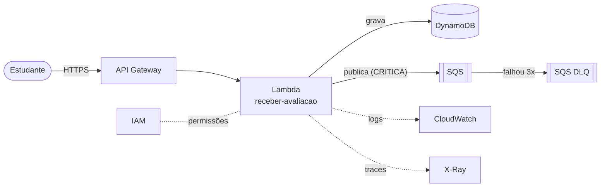

# 2. Os serviços da AWS do projeto

[← Anterior: nuvem e serverless](01-nuvem-e-serverless.md) · [Índice](README.md) · [Próximo: CloudFormation e SAM →](03-cloudformation-e-sam.md)

Cada serviço aqui tem o mesmo formato: **o que é**, **como usamos**, **onde ver no console** e
**custo**. Todos os recursos do projeto começam com `feedback-serverless-`, que é o nome da *stack*
(explicada no [capítulo 3](03-cloudformation-e-sam.md)).

---

## IAM: quem pode fazer o quê

**O que é.** *Identity and Access Management*: o serviço de permissões da AWS. Toda chamada a qualquer
serviço passa por ele.

| Conceito | O que é |
|---|---|
| **Usuário** | Uma identidade com credenciais fixas (senha de console e/ou access key) |
| **Role** | Uma identidade **sem credencial fixa**, "vestida" temporariamente por um serviço ou pessoa |
| **Policy** | Documento JSON que diz o que é permitido ou negado (ação + recurso) |
| **Privilégio mínimo** | Dar só as permissões necessárias, nada além |

**Como usamos.**
- Cada Lambda tem a **sua role**. A da `receber-avaliacao` só pode `dynamodb:PutItem` na tabela e
  `sqs:SendMessage` na fila, além de escrever logs e traces.
- O pipeline usa o **usuário `github-deploy-feedback-serverless`**, com permissão só para os
  serviços da stack.

**Console:** IAM → Funções (roles) → `feedback-serverless-ReceberAvaliacaoFunctionRole-...` ·
IAM → Usuários → `github-deploy-feedback-serverless`

**Custo:** gratuito.

---

## Lambda: onde o código roda

**O que é.** Serviço que executa uma função quando um evento acontece. Você entrega um pacote
(o nosso é um `.zip` com o código Java e as bibliotecas) e configura:

| Configuração | Nosso valor | Para quê |
|---|---|---|
| Runtime | `java21` | Versão do Java |
| Handler | `io.quarkus.amazon.lambda.runtime.QuarkusStreamHandler::handleRequest` | Ponto de entrada: inicia o Quarkus, que chama a nossa classe |
| Memória | 512 MB | Mais memória também dá mais CPU |
| Timeout | 20 s | Tempo máximo de uma execução |
| Variáveis de ambiente | `TABELA_AVALIACOES`, `FILA_CRITICAS_URL` | Nome da tabela e endereço da fila, preenchidos pelo template |

**Como usamos.** A função `feedback-serverless-receber-avaliacao` recebe o `POST /avaliacao`.
O handler é sempre o do Quarkus; a classe que de fato atende é a `ReceberAvaliacaoHandler`
(`@Named("receber")`), escolhida pela configuração `quarkus.lambda.handler=receber`.

**Console:** Lambda → Funções → `feedback-serverless-receber-avaliacao` (abas Código, Configuração,
Monitorar).

**Custo:** sempre gratuito até 1 milhão de requisições e 400.000 GB-segundos por mês.

---

## API Gateway: a porta de entrada HTTP

**O que é.** Serviço que publica uma **API HTTPS** na internet e encaminha cada requisição para
um destino (no nosso caso, a Lambda).

| Conceito | Nosso caso |
|---|---|
| **REST API** | `feedback-serverless-api` |
| **Recurso + método** | `/avaliacao` + `POST` |
| **Stage** | `prod`: a "versão publicada" da API, que entra na URL (`.../prod/avaliacao`) |
| **Integração proxy** | A requisição inteira vai para a Lambda, e a resposta da Lambda volta inteira para o cliente |
| **API key** | Chave obrigatória no header `x-api-key`. Sem ela, o próprio API Gateway responde `403`, e a Lambda nem é chamada |
| **Usage plan (plano de uso)** | Limites por API key: 5 requisições/s (pico de 10) e 10.000 por mês |

**Console:** API Gateway → APIs → `feedback-serverless-api` · API Gateway → Chaves de API (para ver o
valor da chave).

**Custo:** para contas novas, o API Gateway consome **créditos** do plano gratuito. No volume de um
trabalho acadêmico, é uma fração de centavo e nunca cobra o cartão.

---

## DynamoDB: o banco de dados

**O que é.** Banco **NoSQL** gerenciado, chave-valor. Não tem servidor, não tem SQL, não tem
`JOIN`: você grava e lê **itens** por **chave**.

| Conceito | Nosso caso |
|---|---|
| **Tabela** | `feedback-serverless-avaliacoes` |
| **Item** | Uma avaliação (como uma "linha") |
| **Chave de partição (`pk`)** | `DIA#2026-11-03`: agrupa as avaliações do dia (horário de Brasília) |
| **Chave de ordenação (`sk`)** | `2026-11-03T14:22:10Z#<id>`: ordena por horário dentro do dia |
| **Query** | Busca eficiente por `pk`. O relatório faz 7 queries, uma por dia |
| **Scan** | Lê a tabela inteira (lento e caro). Evitamos |
| **Capacidade provisionada** | 5 leituras + 5 escritas por segundo, reservadas |

Por que **provisionada** e não *on-demand*: a cota sempre gratuita do DynamoDB (25 GB e 25 unidades
de leitura e de escrita) vale só para capacidade provisionada.

**Console:** DynamoDB → Tabelas → `feedback-serverless-avaliacoes` → **Explorar itens**.

**Custo:** sempre gratuito dentro da cota acima.

---

## SQS: a fila de mensagens

**O que é.** *Simple Queue Service*: uma **fila**. Um lado (o produtor) coloca mensagens, e o outro
(o consumidor) retira e processa no seu ritmo. Se o consumidor estiver fora do ar, as mensagens
esperam na fila.

| Conceito | Nosso caso |
|---|---|
| **Fila** | `feedback-serverless-avaliacoes-criticas` |
| **Produtor** | `receber-avaliacao`, que publica as avaliações `CRITICA` |
| **Consumidor** | `notificar-urgencia` (próxima etapa), que manda o e-mail |
| **Visibility timeout** | 120 s: enquanto um consumidor processa, a mensagem fica "escondida" dos outros |
| **DLQ (dead-letter queue)** | `feedback-serverless-avaliacoes-criticas-dlq`: se o consumidor falhar 3 vezes com a mesma mensagem, ela vai para cá em vez de se perder |

**Por que uma fila e não chamar a notificação direto?** A resposta ao aluno não espera o e-mail.
Se o e-mail falhar, a mensagem é reprocessada sozinha. E cada função tem uma responsabilidade só.

**Console:** SQS → Filas → `feedback-serverless-avaliacoes-criticas` → **Enviar e receber mensagens** →
**Pesquisar mensagens**.

**Custo:** sempre gratuito até 1 milhão de requisições por mês.

---

## CloudWatch: logs, métricas e alarmes

**O que é.** O serviço de **observabilidade** da AWS.

| Parte | Nosso caso |
|---|---|
| **Logs** | Tudo que a Lambda escreve vai para o grupo `/aws/lambda/feedback-serverless-receber-avaliacao`, guardado por 7 dias |
| **Métricas** | A AWS registra sozinha: invocações, erros, duração e *throttles* de cada Lambda e da API |
| **Alarmes** (próxima etapa) | Ex.: "erros > 0" ou "mensagens na DLQ > 0", que avisam os administradores |

Os logs **não** trazem a descrição da avaliação, que é texto livre do aluno: só `id`, `nota` e `urgencia`.

**Console:** CloudWatch → Grupos de logs · CloudWatch → Métricas · Lambda → função → **Monitorar**.

**Custo:** sempre gratuito até 5 GB de logs, 10 alarmes e 3 dashboards por mês.

---

## X-Ray: o rastreamento

**O que é.** Mostra o **caminho de uma requisição** pelos serviços (API Gateway → Lambda) e quanto
tempo cada trecho levou. Está ligado na API e na Lambda (`Tracing: Active`).

**Console:** CloudWatch → Rastreamentos (X-Ray).

**Custo:** sempre gratuito até 100.000 rastreamentos por mês.

---

## CloudTrail: a auditoria

**O que é.** Registra **quem fez o quê** na conta: cada criação, alteração ou exclusão, com o
usuário ou role que fez. Vem ligado por padrão (*Event history*, 90 dias).

**Por que importa:** é a evidência de **governança de acesso** pedida no enunciado. Dá para ver, por
exemplo, que quem cria as Lambdas é o usuário de deploy, via CloudFormation.

**Console:** CloudTrail → Histórico de eventos.

**Custo:** o histórico de eventos é gratuito.

---

## S3: onde o SAM guarda os pacotes

**O que é.** Armazenamento de arquivos (*buckets* e *objetos*).

**Como usamos.** Não guardamos dados do sistema no S3. Só o **SAM** usa um bucket próprio
(`aws-sam-cli-managed-default-...`), criado sozinho no primeiro deploy, para guardar os `.zip` das
Lambdas antes de o CloudFormation instalá-los.

**Custo:** consome uma fração de centavo dos créditos (poucos MB).

---

## Próximas etapas

| Serviço | Para quê |
|---|---|
| **SNS** ou **SES** | Enviar os e-mails (urgência e relatório). O grupo ainda decide qual |
| **EventBridge Scheduler** | Disparar a `gerar-relatorio-semanal` toda segunda às 08h (fuso de Brasília) |
| **CloudWatch Alarms** | Avisar quando houver erro nas Lambdas ou mensagem na DLQ |

---

[← Anterior: nuvem e serverless](01-nuvem-e-serverless.md) · [Índice](README.md) · [Próximo: CloudFormation e SAM →](03-cloudformation-e-sam.md)
