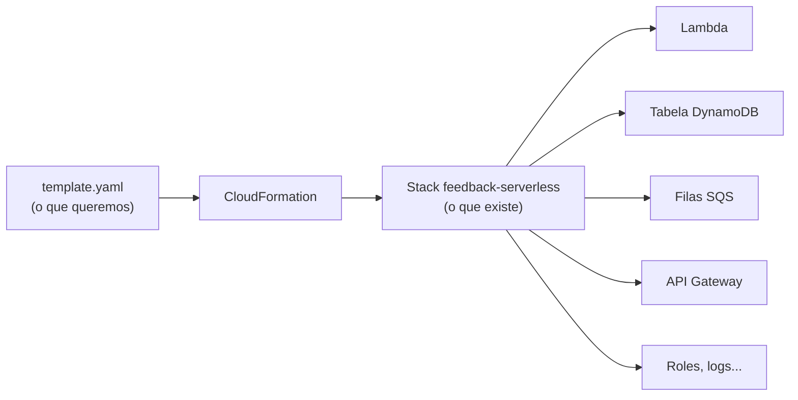

# 3. CloudFormation e SAM: infraestrutura como código

[← Anterior: os serviços da AWS](02-servicos-aws.md) · [Índice](README.md) · [Próximo: GitHub Actions →](04-github-actions.md)

## O problema

Dava para criar a Lambda, a tabela e a fila clicando no console. Só que:

- ninguém lembraria exatamente o que foi configurado;
- recriar o ambiente (ou explicar para o professor) seria refazer tudo de memória;
- duas pessoas mexendo ao mesmo tempo bagunçariam o ambiente.

**Infraestrutura como código (IaC)** resolve isso: a infraestrutura é descrita num **arquivo** que
fica no repositório, passa por pull request e é aplicada automaticamente. Esse arquivo é o
nosso `template.yaml`.

## CloudFormation

**CloudFormation** é o serviço da AWS que lê um template e **cria, atualiza ou apaga recursos** até
a conta ficar igual ao que o arquivo descreve.



| Conceito | O que é | No projeto |
|---|---|---|
| **Template** | Arquivo YAML/JSON que descreve os recursos | `template.yaml` |
| **Stack (pilha)** | O conjunto de recursos criado a partir de um template. É gerenciado como **uma unidade** | `feedback-serverless` |
| **ID lógico** | O nome do recurso **dentro do template** | `TabelaAvaliacoes`, `FilaCriticas`... |
| **ID físico** | O nome **real** na AWS | `feedback-serverless-avaliacoes`... |
| **Outputs (saídas)** | Valores que a stack mostra no fim | URL da API, ID da API key |
| **Eventos** | O histórico de tudo que a stack fez, recurso por recurso | Aba **Eventos** no console |
| **Change set** | A lista do que **vai mudar** antes de aplicar (criar X, alterar Y, apagar Z) | O `sam deploy` gera um a cada deploy |
| **Rollback** | Se algo falha no meio, o CloudFormation **desfaz** e volta ao estado anterior | Automático |

### A pilha em linguagem simples

Pense no `template.yaml` como uma **lista de compras** e na **pilha (stack)** como a **sacola** com
tudo o que foi comprado a partir dela:

- A pilha `feedback-serverless` "guarda" a Lambda, a tabela, as filas, a API, as roles e os logs.
  Cada recurso sabe a qual pilha pertence.
- Mudou a lista (o template)? O CloudFormation ajusta a sacola: compra o que entrou, troca o que
  mudou e devolve o que saiu.
- Apagou a pilha? **Tudo que está dentro dela é apagado junto.**
- No console, a aba **Recursos** da pilha mostra cada item da sacola, com o ID lógico (nome no
  template) e o ID físico (nome real na AWS).

### A regra de ouro: o template é a fonte da verdade

O CloudFormation compara o template **novo** com o que **já existe** na stack, usando o **ID lógico**:

| No template novo... | O CloudFormation... |
|---|---|
| O recurso continua igual | Não faz nada |
| O recurso mudou (ex.: memória da Lambda) | **Atualiza** o mesmo recurso |
| Apareceu um recurso novo | **Cria** |
| Um recurso sumiu | **Apaga** da AWS (cuidado com a tabela!) |

É por isso que dá para fazer deploy quantas vezes quiser sem duplicar nada. O
[capítulo 7](07-perguntas-frequentes.md) detalha isso.

### Lendo os eventos de uma stack

Os eventos aparecem com o **mais recente em cima**. Cada recurso passa por:

```
CREATE_IN_PROGRESS  →  CREATE_COMPLETE      (criado)
UPDATE_IN_PROGRESS  →  UPDATE_COMPLETE      (atualizado)
CREATE_FAILED       →  ROLLBACK_...         (deu erro: leia o "Motivo do status")
```

O status que importa é o da **linha da própria stack**, a que tem o nome da stack no ID lógico. Se ela
está em `CREATE_COMPLETE` ou `UPDATE_COMPLETE`, deu tudo certo, mesmo que as linhas de baixo mostrem
`IN_PROGRESS`. Essas são só os registros do início.

## SAM: CloudFormation simplificado para serverless

O **AWS SAM** (*Serverless Application Model*) é uma extensão do CloudFormation. A linha

```yaml
Transform: AWS::Serverless-2016-10-31
```

no topo do template diz: "antes de aplicar, **expanda** os tipos resumidos do SAM em recursos
CloudFormation normais". Exemplo do que isso economiza:

| Escrevemos (SAM) | Vira (CloudFormation) |
|---|---|
| 1 `AWS::Serverless::Function` | Lambda + **role IAM** + **permissão** para o API Gateway chamar a função |
| 1 `AWS::Serverless::Api` com API key | RestApi + Deployment + Stage + **ApiKey** + **UsagePlan** + vínculo key↔plano |

Nosso template tem 6 recursos escritos à mão, que viram **13 recursos** na AWS:

```
FeedbackApi, FeedbackApiDeployment..., FeedbackApiprodStage,
FeedbackApiApiKey, FeedbackApiUsagePlan, FeedbackApiUsagePlanKey,
ReceberAvaliacaoFunction, ReceberAvaliacaoFunctionRole,
ReceberAvaliacaoFunctionPostAvaliacaoPermissionprod, ReceberAvaliacaoLogs,
TabelaAvaliacoes, FilaCriticas, FilaCriticasDLQ
```

O SAM também traz a **SAM CLI**, o comando `sam` que o pipeline usa para empacotar e publicar
(`sam deploy`).

## O nosso `template.yaml`, por partes

| Bloco | O que define |
|---|---|
| `Globals.Function` | Valores comuns a todas as Lambdas: runtime `java21`, handler do Quarkus, 512 MB, 20 s, X-Ray, tags |
| `TabelaAvaliacoes` | Tabela DynamoDB com `pk`/`sk`, capacidade provisionada 5/5 |
| `FilaCriticasDLQ` | Fila de mensagens que falharam (guarda por 14 dias) |
| `FilaCriticas` | Fila das avaliações críticas, apontando para a DLQ após 3 falhas |
| `FeedbackApi` | REST API, stage `prod`, API key obrigatória e plano de uso |
| `ReceberAvaliacaoLogs` | Grupo de logs com retenção de 7 dias |
| `ReceberAvaliacaoFunction` | A Lambda: pacote (`CodeUri`), variáveis, permissões e o evento `POST /avaliacao` |
| `Outputs` | URL da API, ID da API key, nome da tabela, URL e ARN da fila |

Repare em três detalhes:

- **`CodeUri: receber-avaliacao/target/function.zip`** diz qual pacote vai para cada Lambda. Cada
  módulo Maven gera o seu.
- **`!Ref` e `!GetAtt`** ligam um recurso ao outro. Por exemplo,
  `TABELA_AVALIACOES: !Ref TabelaAvaliacoes` coloca o nome real da tabela na variável da Lambda.
  Nada de nome fixo no código.
- **`Policies`** é o privilégio mínimo: só `PutItem` na tabela e `SendMessage` na fila.

### O bloco que cria a Lambda, linha a linha

**A Lambda é criada por este bloco do `template.yaml`.** Ninguém cria função pelo console:

```yaml
Globals:                       # valores que valem para TODAS as Lambdas do template
  Function:
    Runtime: java21            # versão do Java
    Handler: io.quarkus.amazon.lambda.runtime.QuarkusStreamHandler::handleRequest
                               # ponto de entrada fixo do Quarkus (ele chama a nossa classe @Named)
    MemorySize: 512            # MB de memória (mais memória = mais CPU)
    Timeout: 20                # segundos máximos por execução
    Tracing: Active            # liga o X-Ray

Resources:
  ReceberAvaliacaoFunction:                 # ID LÓGICO: o "nome" deste recurso para o CloudFormation
    Type: AWS::Serverless::Function         # tipo SAM: vira Lambda + role + permissões
    Properties:
      FunctionName: !Sub "${AWS::StackName}-receber-avaliacao"
                                            # nome REAL na AWS → feedback-serverless-receber-avaliacao
      CodeUri: receber-avaliacao/target/function.zip
                                            # QUAL CÓDIGO: o pacote gerado pelo módulo receber-avaliacao
      LoggingConfig:
        LogGroup: !Ref ReceberAvaliacaoLogs # para onde vão os logs (grupo com retenção de 7 dias)
      Environment:
        Variables:                          # variáveis lidas pelo application.properties
          TABELA_AVALIACOES: !Ref TabelaAvaliacoes   # !Ref = "o nome real daquele recurso"
          FILA_CRITICAS_URL: !Ref FilaCriticas       # (para fila, o !Ref devolve a URL)
      Policies:                             # PERMISSÕES da role desta Lambda (privilégio mínimo)
        - Statement:
            - Effect: Allow
              Action: dynamodb:PutItem      # só gravar...
              Resource: !GetAtt TabelaAvaliacoes.Arn   # ...nesta tabela
        - SQSSendMessagePolicy:             # modelo pronto do SAM: só enviar mensagem...
            QueueName: !GetAtt FilaCriticas.QueueName  # ...nesta fila
      Events:                               # O QUE DISPARA a Lambda
        PostAvaliacao:
          Type: Api                         # uma rota do API Gateway...
          Properties:
            RestApiId: !Ref FeedbackApi     # ...na nossa API...
            Path: /avaliacao                # ...no caminho /avaliacao...
            Method: post                    # ...com o método POST
```

Ou seja: **o que** roda está no `CodeUri`, **com que permissão** está em `Policies`, **com que
configuração** está em `Environment` e `Globals`, e **quando** roda está em `Events`.

## Quero criar outro recurso: onde coloco?

**Sempre no `template.yaml`, dentro de `Resources:`.** Nunca pelo console. O passo a passo, com um
exemplo real (o tópico SNS que a `notificar-urgencia` vai usar para mandar e-mail):

**1. Declare o recurso.** Escolha um ID lógico e o tipo. Os tipos e as propriedades estão na
documentação do CloudFormation: pesquise "AWS::SNS::Topic", "AWS::SQS::Queue" e assim por diante.

```yaml
  TopicoAdmins:                              # ID lógico (você escolhe)
    Type: AWS::SNS::Topic                    # tipo do recurso
    Properties:
      TopicName: !Sub "${AWS::StackName}-notificacoes-admin"   # nome real, com o prefixo da stack
```

**2. Ligue à Lambda que vai usar**, sem escrever nome fixo no código:

```yaml
      Environment:
        Variables:
          TOPICO_ADMINS_ARN: !Ref TopicoAdmins          # o código lê esta variável
      Policies:
        - SNSPublishMessagePolicy:                      # permissão só para publicar neste tópico
            TopicName: !GetAtt TopicoAdmins.TopicName
```

**3. (Opcional) Exponha nas saídas**, se alguém precisar do valor:

```yaml
Outputs:
  TopicoAdminsArn:
    Value: !Ref TopicoAdmins
```

**4. Confira se o usuário de deploy tem permissão para esse serviço.** A lista está em
`infra/github-deploy-user.yaml`: CloudFormation, Lambda, API Gateway, DynamoDB, SQS, SNS, SES, Logs,
CloudWatch, Scheduler, EventBridge e X-Ray. Se o recurso for de **outro** serviço (ex.: Step
Functions), adicione a ação nesse arquivo e **atualize a pilha `github-deploy-user` à mão**:
CloudFormation → `github-deploy-user` → **Atualizar pilha** → **Substituir o modelo existente**. O
pipeline não mexe nessa pilha.

**5. Abra o PR e faça o merge.** No log do deploy, o change set mostra `+ Add TopicoAdmins`. O
CloudFormation cria o tópico e atualiza a role da Lambda. Nada é duplicado.

Para conferir antes de abrir o PR, dá para validar o template localmente com o
[`cfn-lint`](https://github.com/aws-cloudformation/cfn-lint) (`pip install cfn-lint` e depois
`cfn-lint template.yaml`).

| Dica | Por quê |
|---|---|
| Use `!Sub "${AWS::StackName}-..."` nos nomes | Todo recurso fica com o prefixo `feedback-serverless-` e é fácil de achar |
| Use `!Ref` e `!GetAtt` em vez de copiar nomes e ARNs | Se o recurso mudar, a referência acompanha |
| Dê à Lambda só a permissão que ela usa | Privilégio mínimo é critério de avaliação (segurança) |
| Não renomeie o ID lógico de um recurso que já existe | Para o CloudFormation, ID novo é **outro** recurso: ele cria um novo e apaga o antigo, e numa tabela isso apaga os dados |

## `samconfig.toml`: as respostas do `sam deploy`

Em vez de passar parâmetros toda vez, o `sam deploy` lê este arquivo:

| Chave | Valor | Significado |
|---|---|---|
| `stack_name` | `feedback-serverless` | Nome da stack (e prefixo dos recursos) |
| `region` | `us-east-2` | Região do projeto |
| `capabilities` | `CAPABILITY_IAM` | Autoriza o template a criar roles IAM |
| `resolve_s3` | `true` | O SAM cria e usa o bucket dele para os `.zip` |
| `fail_on_empty_changeset` | `false` | Deploy sem mudança termina com sucesso, sem erro |

## As três stacks que existem na conta

| Stack | Criada por | Para quê |
|---|---|---|
| `feedback-serverless` | Pipeline (`sam deploy`) | **A aplicação**: tudo do `template.yaml` |
| `aws-sam-cli-managed-default` | SAM, sozinho, no 1º deploy | O bucket S3 onde o SAM guarda os pacotes |
| `github-deploy-user` | Nós, uma vez, pelo console | O usuário IAM que o pipeline usa (`infra/github-deploy-user.yaml`) |

A `github-deploy-user` fica separada de propósito: ela dá ao pipeline a permissão de fazer deploy,
então não pode ser criada pelo próprio pipeline.

## Onde fica cada configuração

| Quero mudar... | Arquivo | Quem aplica |
|---|---|---|
| Recursos da AWS (Lambda, tabela, filas, API, logs, permissões das Lambdas) | `template.yaml` | O pipeline, no merge |
| Memória, timeout ou runtime de **todas** as Lambdas | `template.yaml` → `Globals` | O pipeline, no merge |
| Nome da stack, região, bucket do SAM | `samconfig.toml` | O pipeline, no merge |
| Configuração **da aplicação** (handler, nomes lidos das variáveis) | `<modulo>/src/main/resources/application.properties` | Vai dentro do `function.zip` |
| Dependências e módulos Maven | `pom.xml` (raiz e de cada módulo) | O build |
| Passos do pipeline | `.github/workflows/ci-cd.yml` | O GitHub Actions |
| Permissões do **pipeline** na AWS | `infra/github-deploy-user.yaml` | **Você, à mão**, atualizando a pilha `github-deploy-user` |
| Credenciais do pipeline | Secrets do GitHub (`AWS_ACCESS_KEY_ID`, `AWS_SECRET_ACCESS_KEY`) | Admin do repositório |

---

[← Anterior: os serviços da AWS](02-servicos-aws.md) · [Índice](README.md) · [Próximo: GitHub Actions →](04-github-actions.md)
