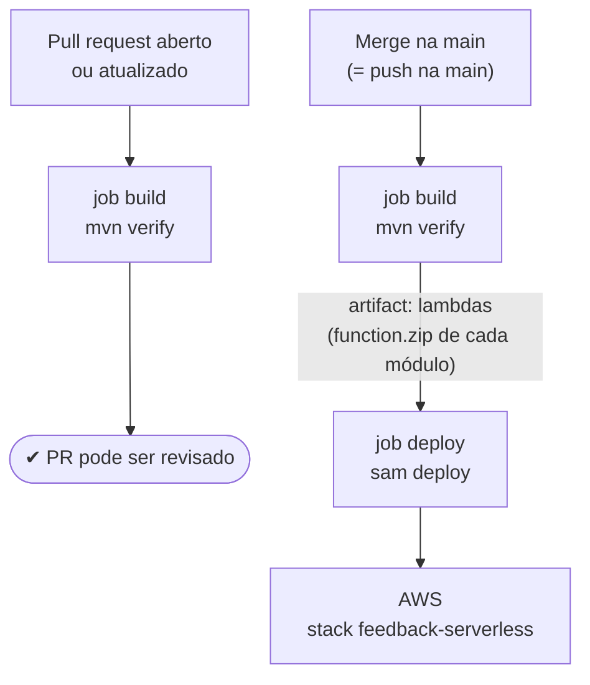

# 4. GitHub Actions: o pipeline de CI/CD

[← Anterior: CloudFormation e SAM](03-cloudformation-e-sam.md) · [Índice](README.md) · [Próximo: como o deploy funciona →](05-deploy.md)

## CI/CD em uma frase

- **CI (integração contínua):** a cada mudança, um robô compila e roda os testes. Assim ninguém
  descobre depois que a `main` quebrou.
- **CD (entrega/deploy contínuo):** quando a mudança é aceita, o mesmo robô **publica** na AWS.
  Ninguém faz deploy da própria máquina.

O enunciado exige "deploy automatizado dos componentes atualizáveis (ex.: funções)". É isso.

## GitHub Actions

É o serviço de CI/CD do próprio GitHub. Você descreve o que fazer num arquivo YAML dentro de
`.github/workflows/`, e o GitHub executa em máquinas dele.

| Conceito | O que é | No nosso arquivo |
|---|---|---|
| **Workflow** | O arquivo inteiro, com um nome | `.github/workflows/ci-cd.yml` → `ci-cd` |
| **Gatilho (`on`)** | Quando o workflow roda | `pull_request` e `push` na `main` |
| **Job** | Um bloco de trabalho, que roda numa máquina limpa | `build` e `deploy` |
| **Step** | Um passo dentro do job | `checkout`, `setup-java`, `mvn verify`... |
| **Runner** | A máquina virtual que executa o job | `ubuntu-latest` |
| **Action (`uses:`)** | Um passo pronto, publicado por alguém | `actions/checkout`, `aws-actions/setup-sam`... |
| **Artifact** | Arquivo passado de um job para outro | `lambdas` (os `function.zip`) |
| **Secret** | Valor sensível guardado criptografado no repositório, que não aparece nos logs | `AWS_ACCESS_KEY_ID`, `AWS_SECRET_ACCESS_KEY` |
| **`needs`** | Um job espera outro terminar com sucesso | `deploy` precisa de `build` |
| **`concurrency`** | Impede duas execuções do mesmo grupo ao mesmo tempo | `deploy-aws` |

## O nosso `ci-cd.yml`



### Job `build` (roda em todo PR e em todo push na `main`)

1. `actions/checkout`: baixa o código.
2. `actions/setup-java`: instala o Java 21 e guarda as dependências do Maven em cache.
3. `mvn -B verify`: na raiz, compila **todos os módulos**, roda **todos os testes** e gera um
   `function.zip` por Lambda (`receber-avaliacao/target/function.zip`...).
4. `actions/upload-artifact`: guarda os `*/target/function.zip` com o nome `lambdas`.

Se um teste falha, o job fica **vermelho** e o PR mostra o erro. Não dá para fazer merge sem ver.

### Job `deploy` (só em push na `main`, depois do `build`)

1. Se os secrets da AWS não existem, só avisa e para, sem falhar.
2. `actions/checkout`: baixa o código, que traz o `template.yaml` e o `samconfig.toml`.
3. `actions/download-artifact`: pega os `function.zip` gerados no job `build`.
4. `aws-actions/setup-sam`: instala a SAM CLI.
5. `aws-actions/configure-aws-credentials`: faz login na AWS com os secrets, na região `us-east-2`.
6. `sam deploy`: publica. O [capítulo 5](05-deploy.md) explica o que ele faz por dentro.

## O fluxo de trabalho do grupo

A `main` é protegida: **ninguém faz push direto nela**. Todo código entra por pull request:

```bash
git checkout main && git pull                 # parte da versão mais nova
git checkout -b feat/notificar-urgencia       # uma branch por tarefa
# ... código + testes ...
mvn verify                                    # roda local antes de subir
git add . && git commit -m "feat: ..."
git push -u origin feat/notificar-urgencia
# abre o PR no GitHub → job build roda → revisão → merge → job deploy roda
```

## Onde acompanhar

- **GitHub → aba Actions:** cada execução, cada job e o log de cada step.
- **No próprio PR:** o resultado do job `build` aparece como *check*.
- **AWS → CloudFormation → `feedback-serverless` → Eventos:** o que o deploy mudou na AWS.

## Custo

O repositório é privado. O plano gratuito do GitHub inclui uma cota mensal de minutos de Actions
para repositórios privados (2.000 min/mês no GitHub Free), e um build nosso leva poucos minutos.

---

[← Anterior: CloudFormation e SAM](03-cloudformation-e-sam.md) · [Índice](README.md) · [Próximo: como o deploy funciona →](05-deploy.md)
