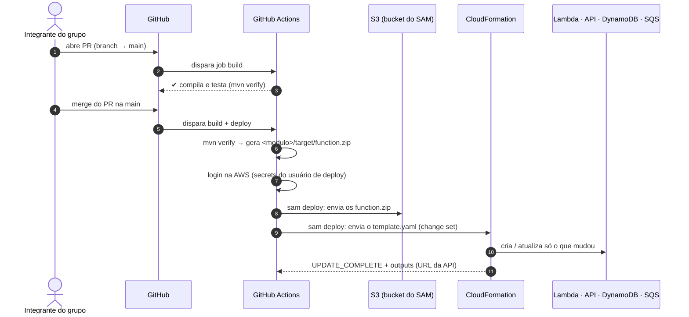

# 5. Como o deploy funciona

[← Anterior: GitHub Actions](04-github-actions.md) · [Índice](README.md) · [Próximo: o caminho de uma avaliação →](06-fluxo-de-uma-avaliacao.md)

Este capítulo junta tudo: o caminho do código até a Lambda, como o repositório está organizado
para isso, a configuração feita uma única vez e o que fazer no dia a dia.

## A Lambda não "puxa" o código do GitHub

Nenhum serviço da AWS fica olhando o repositório. Quem **leva** o código até a AWS é o pipeline:



## Como o repositório está organizado para o deploy

```
tech-challenge4/
├── pom.xml                      ← POM pai: lista os módulos
├── shared/                      ← domínio e contratos (Java puro, vira um .jar comum)
├── receber-avaliacao/           ← módulo da Lambda → gera receber-avaliacao/target/function.zip
├── notificar-urgencia/          ← (próxima) → notificar-urgencia/target/function.zip
├── gerar-relatorio-semanal/     ← (próxima) → gerar-relatorio-semanal/target/function.zip
├── template.yaml                ← UMA stack com todas as Lambdas, cada uma com seu CodeUri
├── samconfig.toml               ← parâmetros do sam deploy
├── infra/github-deploy-user.yaml← usuário de deploy (criado uma vez)
└── .github/workflows/ci-cd.yml  ← o pipeline
```

- **Um módulo Maven por Lambda.** Cada uma tem o seu código, os seus testes e só as dependências
  que usa. O `shared` guarda o que é comum (regra de urgência, formato da tabela e da mensagem da fila).
- **Um pacote por Lambda.** A extensão `quarkus-amazon-lambda` gera, no `mvn package`, um
  `target/function.zip` com o código do módulo, o `shared` e as bibliotecas.
- **Uma stack só.** O `template.yaml` declara todas as Lambdas, e cada uma aponta para o seu zip
  (`CodeUri`). Um único `sam deploy` publica tudo.

## O que o `sam deploy` faz, passo a passo

1. Lê o `samconfig.toml`: stack `feedback-serverless`, região `us-east-2`.
2. Para cada `CodeUri` do template, **envia o `.zip` ao bucket S3** do SAM. O nome do arquivo é um
   hash do conteúdo, e se o zip não mudou, não reenvia.
3. Troca, no template, o caminho local (`receber-avaliacao/target/function.zip`) pelo endereço no S3.
4. Pede ao CloudFormation um **change set**: a lista do que vai ser criado, alterado ou removido.
   Aparece no log do job.
5. **Executa** o change set e espera a stack terminar.
6. Mostra os **outputs**, como a URL da API.

Se algo falha no meio, o CloudFormation faz **rollback** sozinho e a versão anterior continua no ar.

## Credenciais: por que um usuário IAM e não OIDC

O ideal seria o GitHub Actions entrar na AWS por **OIDC**, com um token temporário a cada execução e
nenhuma chave guardada. Tentamos, e a criação falhou com:

```
... is not authorized to perform: iam:CreateOpenIDConnectProvider ...
with an explicit deny in a service control policy
```

Na experiência nova da AWS, o projeto vem com políticas (SCPs) que **a AWS gerencia e nós não podemos
mudar**. Uma delas, `DenyIAMRestrictedActions`, bloqueia `iam:*Provider*`. Criar usuário IAM com
access key é permitido, então usamos isso, com proteções:

| Proteção | Como |
|---|---|
| A chave não está no código | Fica só nos **Secrets** do GitHub (criptografada, escondida nos logs) |
| Permissão mínima | O usuário só alcança os serviços da stack, o bucket do SAM, as roles `feedback-serverless-*` e a role de serviço do API Gateway |
| Sem acesso humano | O usuário não tem senha de console |
| Auditoria | Tudo que ele faz aparece no CloudTrail como `github-deploy-feedback-serverless` |
| Fim de vida | Ao fim da disciplina, a chave é desativada e a stack `github-deploy-user` é apagada |

## Configuração inicial (feita uma vez, já concluída)

Fica registrado aqui para referência, ou para refazer numa conta nova.

**1. Criar o usuário de deploy:** CloudFormation (`us-east-2`) → **Criar pilha** → **Com novos
recursos** → upload de `infra/github-deploy-user.yaml` → nome `github-deploy-user` → marcar
"reconheço que o CloudFormation pode criar recursos do IAM com nomes personalizados" → **Enviar** →
esperar `CREATE_COMPLETE`.

**2. Criar a access key:** IAM → Usuários → `github-deploy-feedback-serverless` → **Credenciais de
segurança** → **Criar chave de acesso** → caso de uso "Aplicação em execução fora da AWS". A chave
secreta só aparece uma vez.

**3. Cadastrar os secrets:** GitHub → repositório → **Settings** → **Secrets and variables** →
**Actions** → criar `AWS_ACCESS_KEY_ID` e `AWS_SECRET_ACCESS_KEY`.

**4. Fazer merge de um PR na `main`.** O job `deploy` cria a stack `feedback-serverless`.

## Depois do deploy: URL e API key

- **CloudFormation** → `feedback-serverless` → aba **Saídas**: `UrlAvaliacao` (o endpoint) e
  `ApiKeyId`.
- **API Gateway** → **Chaves de API** → a chave → **Mostrar**: é o valor que vai no header `x-api-key`.

Não coloque o valor da API key no repositório. O [capítulo 6](06-fluxo-de-uma-avaliacao.md) mostra
como testar.

## Dia a dia

| Quero... | Faço... |
|---|---|
| Mudar o código de uma Lambda | Branch → código + testes → PR → merge. O deploy atualiza a Lambda |
| Mudar uma configuração (memória, timeout, fila...) | Altero o `template.yaml` → PR → merge |
| Criar uma Lambda nova | Sigo o `README.md` da pasta dela (módulo Maven + `<module>` no POM pai + função no `template.yaml`) → PR → merge |
| Desfazer uma mudança ruim | `git revert` do commit → PR → merge. O deploy volta a versão anterior |
| Ver se o deploy deu certo | GitHub → Actions (job `deploy` verde) e CloudFormation → Eventos (`UPDATE_COMPLETE`) |
| Ver erro da Lambda | CloudWatch → Grupos de logs → `/aws/lambda/feedback-serverless-receber-avaliacao` |

**Nunca** altere pelo console algo que está no template. No próximo deploy o CloudFormation pode
desfazer a mudança, e ninguém mais sabe o que está rodando.

## Remover tudo (depois da avaliação)

No CloudFormation, apague nesta ordem:

1. `feedback-serverless`: Lambda, API, tabela (**os dados somem**), filas e logs.
2. `aws-sam-cli-managed-default`: esvazie o bucket S3 dela antes.
3. `github-deploy-user`: o usuário de deploy. A access key deixa de valer.

Depois, apague os dois secrets no GitHub.

---

[← Anterior: GitHub Actions](04-github-actions.md) · [Índice](README.md) · [Próximo: o caminho de uma avaliação →](06-fluxo-de-uma-avaliacao.md)
