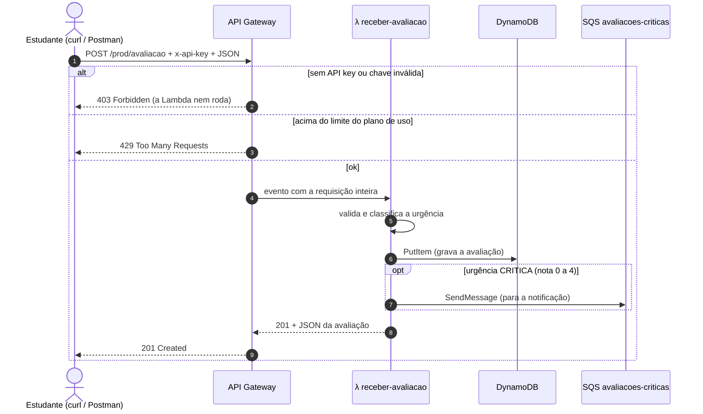
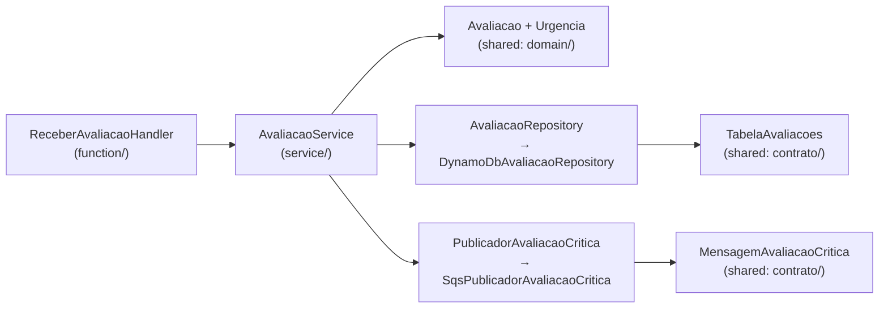

# 6. O caminho de uma avaliação

[← Anterior: como o deploy funciona](05-deploy.md) · [Índice](README.md) · [Próximo: perguntas frequentes →](07-perguntas-frequentes.md)

Este capítulo acompanha uma requisição `POST /avaliacao` do começo ao fim: primeiro pelos serviços
da AWS, depois pelas classes Java.

## Pelos serviços da AWS



## Pelas classes Java

Cada camada tem uma responsabilidade, no estilo hexagonal: a regra de negócio não conhece a AWS.



| Passo | Classe (módulo) | O que faz |
|---|---|---|
| 1 | `ReceberAvaliacaoHandler` (`receber-avaliacao`) | Recebe o evento do API Gateway, lê o JSON e confere os **tipos**: `descricao` texto, `nota` inteiro. Converte o resultado em HTTP 201, 400 ou 500 |
| 2 | `AvaliacaoService` (`receber-avaliacao`) | O caso de uso: cria a avaliação, grava e, se for crítica, publica |
| 3 | `Avaliacao.nova(...)` (`shared`) | Regras de negócio: descrição obrigatória e com até 1000 caracteres, nota obrigatória de 0 a 10. Gera o `id` e a `dataEnvio` |
| 4 | `Urgencia.daNota(...)` (`shared`) | 0–4 `CRITICA`, 5–7 `MEDIA`, 8–10 `BAIXA` |
| 5 | `DynamoDbAvaliacaoRepository` (`receber-avaliacao`) | Monta o item com as chaves de `TabelaAvaliacoes` e faz `PutItem` |
| 6 | `SqsPublicadorAvaliacaoCritica` (`receber-avaliacao`) | Converte para `MensagemAvaliacaoCritica` (JSON) e faz `SendMessage` |

Por que `TabelaAvaliacoes` e `MensagemAvaliacaoCritica` ficam no `shared`: quem **grava** a tabela
(`receber-avaliacao`) e quem **lê** (`gerar-relatorio-semanal`) usam o mesmo formato de chave. Quem
**publica** na fila e quem **consome** (`notificar-urgencia`) usam a mesma mensagem. Assim os dois
lados nunca divergem.

## O que é gravado

```json
{
  "pk": "DIA#2026-11-03",
  "sk": "2026-11-03T14:22:10Z#7f3c...",
  "id": "7f3c...",
  "descricao": "Aula com áudio ruim",
  "nota": 2,
  "urgencia": "CRITICA",
  "dataEnvio": "2026-11-03T14:22:10Z"
}
```

O dia da partição (`pk`) usa o **horário de Brasília**. Uma avaliação das 22h30 do dia 3 é
`2026-11-04T01:30Z` em UTC, mas entra em `DIA#2026-11-03`.

## Respostas possíveis

| Situação | HTTP | Corpo |
|---|---|---|
| Avaliação válida | `201` | `{ "id", "descricao", "nota", "urgencia", "dataEnvio" }` |
| Corpo vazio, JSON inválido, descrição vazia ou acima de 1000 caracteres, nota ausente, fora de 0–10, decimal (`7.5`) ou texto (`"7"`) | `400` | `{ "erro": "<motivo>" }` |
| Sem API key ou chave errada | `403` | Resposta do próprio API Gateway |
| Acima do limite de requisições | `429` | Resposta do próprio API Gateway |
| Falha ao gravar no DynamoDB | `500` | `{ "erro": "erro interno ao registrar a avaliação" }`. O detalhe fica só no log |

**E se a fila falhar?** A avaliação **já está gravada** quando a publicação acontece. Então a
resposta continua `201`: se fosse erro, o aluno reenviaria e criaria uma avaliação duplicada. A
falha vai para o log com o marcador `FALHA_PUBLICACAO_CRITICA`, que vai virar alarme no CloudWatch.

## Testando

Pegue a **URL** e a **API key** como no [capítulo 5](05-deploy.md#depois-do-deploy-url-e-api-key):

```bash
URL="<UrlAvaliacao>"
KEY="<valor da API key>"

# nota alta → 201, urgência BAIXA, só grava
curl -i -X POST "$URL" -H "x-api-key: $KEY" -H "Content-Type: application/json" \
  -d '{"descricao":"Aula muito boa","nota":9}'

# nota baixa → 201, urgência CRITICA, grava e publica na fila
curl -i -X POST "$URL" -H "x-api-key: $KEY" -H "Content-Type: application/json" \
  -d '{"descricao":"Audio da aula ruim","nota":2}'

# sem API key → 403
curl -i -X POST "$URL" -H "Content-Type: application/json" -d '{"descricao":"x","nota":5}'

# nota inválida → 400
curl -i -X POST "$URL" -H "x-api-key: $KEY" -H "Content-Type: application/json" \
  -d '{"descricao":"x","nota":11}'
```

A primeira chamada pode levar alguns segundos por causa do cold start.

## Onde ver o resultado (bom para o vídeo)

| Onde | O que aparece |
|---|---|
| **DynamoDB** → `feedback-serverless-avaliacoes` → **Explorar itens** | As duas avaliações válidas |
| **SQS** → `feedback-serverless-avaliacoes-criticas` → **Enviar e receber mensagens** → **Pesquisar mensagens** | Só a mensagem da nota 2 |
| **CloudWatch** → Grupos de logs → `/aws/lambda/feedback-serverless-receber-avaliacao` | `Avaliacao registrada id=... nota=2 urgencia=CRITICA` e `Avaliacao critica enviada para a fila` |
| **Lambda** → a função → **Monitorar** | Gráficos de invocações, duração e erros |
| **CloudWatch** → **Rastreamentos** | O caminho API Gateway → Lambda de cada chamada |

## Testes automatizados

Rodam no `mvn verify`, na sua máquina e no pipeline. Não precisam da AWS:

| Teste | Módulo | Garante |
|---|---|---|
| `UrgenciaTest` | `shared` | Limites da regra (0, 4, 5, 7, 8, 10, -1, 11) |
| `AvaliacaoTest` | `shared` | Validações e dia no horário de Brasília |
| `TabelaAvaliacoesTest` | `shared` | Formato de `pk`/`sk` e da mensagem da fila |
| `AvaliacaoServiceTest` | `receber-avaliacao` | Grava sempre, publica só crítica e não perde o registro se a fila falhar |
| `SqsPublicadorAvaliacaoCriticaTest` | `receber-avaliacao` | JSON da mensagem com os campos do e-mail |
| `ReceberAvaliacaoHandlerTest` | `receber-avaliacao` | 201, os 12 casos de 400 e o 500 sem vazar detalhes |

---

[← Anterior: como o deploy funciona](05-deploy.md) · [Índice](README.md) · [Próximo: perguntas frequentes →](07-perguntas-frequentes.md)
