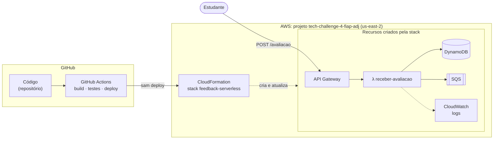

# Documentação do projeto

Esta pasta explica, do zero, tudo o que o projeto usa: o que é cada serviço da AWS, como a
infraestrutura é criada, como o GitHub Actions faz o deploy e o caminho que uma avaliação percorre
pelo código. A leitura é **sequencial**: cada capítulo usa o que o anterior explicou.

## Trilha de leitura

| # | Capítulo | Você vai entender |
|---|---|---|
| 1 | [Nuvem e serverless](01-nuvem-e-serverless.md) | O que é nuvem, região, conta/projeto, serverless e cold start |
| 2 | [Os serviços da AWS do projeto](02-servicos-aws.md) | IAM, Lambda, API Gateway, DynamoDB, SQS, CloudWatch e os outros, um por um |
| 3 | [CloudFormation e SAM](03-cloudformation-e-sam.md) | Infraestrutura como código: template, stack, como o `template.yaml` vira recursos |
| 4 | [GitHub Actions](04-github-actions.md) | CI/CD, workflow, job, step, secrets e o nosso `ci-cd.yml` |
| 5 | [Como o deploy funciona](05-deploy.md) | O caminho completo do código até a Lambda, a configuração inicial e o dia a dia |
| 6 | [O caminho de uma avaliação](06-fluxo-de-uma-avaliacao.md) | O que acontece em cada camada quando alguém chama `POST /avaliacao`, e como testar |
| 7 | [Perguntas frequentes](07-perguntas-frequentes.md) | "Posso fazer deploy várias vezes?", "vai criar recurso novo toda vez?" e outras |
| 8 | [Glossário](08-glossario.md) | Os termos em uma linha cada |

Se tiver pouco tempo, leia o **1**, o **5** e o **7**.

## O projeto em uma imagem

Lendo da esquerda para a direita:

- **GitHub** guarda o código. A cada merge na `main`, o **GitHub Actions** compila, testa e manda
  publicar.
- **CloudFormation** é o serviço da AWS que lê o nosso `template.yaml` e cria ou atualiza os
  recursos. A gente nunca cria Lambda, tabela ou fila clicando no console.
- **Estudante → API Gateway → Lambda → DynamoDB/SQS** é o caminho de uma avaliação quando o
  sistema está no ar.
