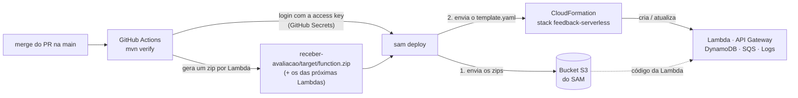

# Passo a passo: do código no GitHub até a Lambda rodando na AWS

Este guia mostra como a função `receber-avaliacao` sai do repositório e vira uma Lambda
funcionando na AWS, e como repetir isso a cada mudança.

## 0. Como o código chega na Lambda

A Lambda **não busca o código no GitHub sozinha**. Quem leva o código até ela é o
**pipeline** (GitHub Actions) usando o **AWS SAM**:



1. O `mvn verify` na raiz compila e testa todos os módulos, e gera um pacote por Lambda
   (`receber-avaliacao/target/function.zip` etc.).
2. O GitHub Actions faz login na AWS com a access key de um **usuário IAM de deploy**, guardada
   nos **Secrets** do GitHub. Esse usuário tem permissões limitadas aos serviços do projeto (passo 3).
3. O `sam deploy` sobe os zips para um bucket S3 e entrega o `template.yaml` ao
   **CloudFormation**, que cria ou atualiza todos os recursos: Lambda, API Gateway,
   tabela, filas e logs. Esse conjunto de recursos é a **stack** `feedback-serverless`.
4. A cada merge na `main` o ciclo se repete. O CloudFormation só altera o que mudou.

> A `main` é protegida: o código entra por pull request. No PR o pipeline só compila e testa.
> O deploy acontece quando o PR é aceito (merge na `main`).

---

## 1. Pré-requisitos

| O quê | Para quê |
|---|---|
| Acesso de **admin** ao repositório no GitHub | Cadastrar o secret do deploy (passo 4) |
| Acesso ao projeto AWS `tech-challenge-4-fiap-adj` (região **us-east-2**, Ohio) | Criar o usuário de deploy (passo 3) e conferir os recursos |
| Opcional: Java 21 + Maven 3.9 na máquina | Rodar os testes localmente (`mvn verify`) |

Não é preciso instalar AWS CLI nem SAM CLI na sua máquina: o deploy roda no GitHub Actions.

---

## 2. Subir o código por pull request

```bash
git checkout -b feat/receber-avaliacao
git add .
git commit -m "feat: lambda receber-avaliacao com API Gateway, DynamoDB e SQS"
git push -u origin feat/receber-avaliacao
```

No GitHub, abra o pull request da branch para a `main`. O workflow `ci-cd` roda o job
**Build e testes**, que precisa ficar verde antes do merge.

Depois do merge, o workflow roda de novo na `main`. Até os passos 3 e 4 serem feitos, o job
**Deploy na AWS** termina com um aviso de que os secrets da AWS não estão configurados.
É esperado.

---

## 3. Criar o usuário de deploy na AWS (uma vez só)

> **Por que não OIDC?** O normal seria o GitHub Actions entrar na AWS por OIDC, com token temporário
> e sem chave guardada. Mas o projeto da nova experiência AWS tem uma política gerenciada pela AWS
> (SCP `DenyIAMRestrictedActions`) que bloqueia a criação de provedores de identidade
> (`iam:*Provider*`). A tentativa termina em `CREATE_FAILED ... explicit deny in a service control policy`.
> Criar usuário IAM com access key é permitido, então o deploy usa esse caminho, com as
> proteções abaixo.

O arquivo `infra/github-deploy-user.yaml` cria o usuário **`github-deploy-feedback-serverless`**,
com permissão **somente** para os serviços da stack (CloudFormation, Lambda, API Gateway,
DynamoDB, SQS, SNS/SES, CloudWatch, Scheduler), para o bucket do SAM e para as roles que começam
com `feedback-serverless-`, que são as roles das Lambdas.

**3.1. Criar a pilha** (console da AWS, região **us-east-2**):

1. **CloudFormation** → **Criar pilha** → **Com novos recursos (padrão)**.
2. **Fazer upload de um arquivo de modelo** → escolha `infra/github-deploy-user.yaml` → Próximo.
3. Nome da pilha: `github-deploy-user` → avance com os valores padrão.
4. Na revisão, marque **"Eu reconheço que o AWS CloudFormation pode criar recursos do IAM com
   nomes personalizados"** → **Enviar**.
5. Espere **CREATE_COMPLETE**.

**3.2. Criar a access key:**

1. **IAM** → **Usuários** → `github-deploy-feedback-serverless` → aba **Credenciais de segurança**.
2. **Chaves de acesso** → **Criar chave de acesso** → caso de uso **"Aplicação em execução fora da AWS"**
   → Próximo → **Criar chave de acesso**.
3. Copie o **ID da chave de acesso** e a **Chave de acesso secreta**. A secreta só aparece
   **essa vez**. Não salve em arquivo do repositório, não mande no chat do grupo, e vá direto
   para o passo 4.

**Cuidados com a chave:**
- Ela fica **só** nos Secrets do GitHub, que guardam o valor criptografado e escondem nos logs.
- O usuário não tem senha de console e só alcança os serviços da stack.
- Tudo o que ele faz aparece no **CloudTrail** com o nome `github-deploy-feedback-serverless`.
- Ao fim da disciplina, desative ou apague a chave (passo 11).

---

## 4. Cadastrar os secrets no GitHub

No repositório: **Settings** → **Secrets and variables** → **Actions** → **New repository secret**.
Crie dois secrets:

| Name | Secret |
|---|---|
| `AWS_ACCESS_KEY_ID` | o ID da chave de acesso |
| `AWS_SECRET_ACCESS_KEY` | a chave de acesso secreta |

> Só quem é admin do repositório vê o menu Settings. Se você não for, peça para a dona
> do repositório (carpejen) cadastrar.

---

## 5. Fazer o deploy

Rode de novo o workflow da `main`: aba **Actions** → `ci-cd` → última execução da `main` →
**Re-run all jobs**. Também funciona fazer o merge de qualquer novo PR.

Acompanhe em dois lugares:

- **GitHub Actions:** o job *Deploy na AWS* mostra o `sam deploy` listando o que vai criar.
- **AWS CloudFormation:** a stack `feedback-serverless` aparece, e a aba **Eventos** mostra cada
  recurso sendo criado. No fim o status deve ser **CREATE_COMPLETE** (ou **UPDATE_COMPLETE** nos
  deploys seguintes).

O SAM também cria uma stack auxiliar chamada `aws-sam-cli-managed-default`, com o bucket S3 onde
ele guarda os pacotes das Lambdas. Isso é normal.

---

## 6. Pegar a URL e a API key

Na stack `feedback-serverless`, aba **Saídas** (Outputs):

| Saída | O que é |
|---|---|
| `UrlAvaliacao` | Endpoint do `POST /avaliacao` |
| `ApiKeyId` | ID da API key criada pelo SAM |

Para ver o **valor** da API key: **API Gateway** → **Chaves de API** (API keys) → clique na chave →
**Mostrar**. Pela CLI, o comando equivalente é
`aws apigateway get-api-key --include-value --api-key <ApiKeyId>`.

> Não coloque o valor da API key no repositório (ele é público). Use só no Postman ou no curl.

---

## 7. Testar

```bash
URL="<UrlAvaliacao>"
KEY="<valor da API key>"

# Nota alta → 201, urgência BAIXA, só grava
curl -i -X POST "$URL" -H "x-api-key: $KEY" -H "Content-Type: application/json" \
  -d '{"descricao":"Aula muito boa","nota":9}'

# Nota baixa → 201, urgência CRITICA, grava e manda para a fila
curl -i -X POST "$URL" -H "x-api-key: $KEY" -H "Content-Type: application/json" \
  -d '{"descricao":"Audio da aula ruim","nota":2}'

# Sem API key → 403 (barrado no API Gateway, a Lambda nem é chamada)
curl -i -X POST "$URL" -H "Content-Type: application/json" -d '{"descricao":"x","nota":5}'

# Nota inválida → 400
curl -i -X POST "$URL" -H "x-api-key: $KEY" -H "Content-Type: application/json" \
  -d '{"descricao":"x","nota":11}'
```

A primeira chamada pode demorar alguns segundos. É o *cold start* do Java; as chamadas seguintes são rápidas.

---

## 8. Conferir na AWS (bom para o vídeo)

| Onde | O que ver |
|---|---|
| **DynamoDB** → Tabelas → `feedback-serverless-avaliacoes` → **Explorar itens** | As avaliações gravadas, com `pk = DIA#...` |
| **SQS** → `feedback-serverless-avaliacoes-criticas` → **Enviar e receber mensagens** → **Pesquisar mensagens** | A mensagem da avaliação crítica (nota 2) |
| **CloudWatch** → Grupos de logs → `/aws/lambda/feedback-serverless-receber-avaliacao` | Logs `Avaliacao registrada id=... urgencia=...` (a descrição não é logada) |
| **X-Ray** / CloudWatch → Rastreamentos | O caminho API Gateway → Lambda → DynamoDB/SQS |
| **Lambda** → `feedback-serverless-receber-avaliacao` → Configuração | Variáveis de ambiente, role e permissões |

---

## 9. Atualizar a Lambda depois

1. Crie uma branch, altere o código e abra um pull request. O pipeline roda os testes.
2. Faça o merge na `main`. O pipeline publica a nova versão.

Não tem passo manual: **o código no GitHub (main) é sempre o que está na AWS**.

---

## 10. Problemas comuns

| Sintoma | Causa provável |
|---|---|
| Job de deploy com aviso "secret não configurado" | Faltou o passo 4 |
| `InvalidClientTokenId` / `SignatureDoesNotMatch` | Secret `AWS_ACCESS_KEY_ID` ou `AWS_SECRET_ACCESS_KEY` copiado errado |
| `... is not authorized to perform ...` no deploy | Falta permissão no usuário de deploy: adicione a ação em `infra/github-deploy-user.yaml` e atualize a pilha `github-deploy-user` |
| CloudFormation `ROLLBACK_COMPLETE` | Veja o primeiro evento em vermelho na aba Eventos. Depois apague a stack antes de tentar de novo |
| `403 Forbidden` no curl | Header `x-api-key` ausente ou com valor errado |
| `500` na resposta | Veja o log da Lambda no CloudWatch |
| `429 Too Many Requests` | Limite do plano de uso (5 req/s, pico de 10) |

---

## 11. Remover tudo (depois da avaliação)

No CloudFormation, apague nesta ordem:

1. `feedback-serverless` (Lambda, API, tabela, filas e logs);
2. `aws-sam-cli-managed-default` (esvazie o bucket S3 dela antes);
3. `github-deploy-user`: apaga o usuário de deploy e invalida a access key. Também apague os dois secrets no GitHub.
